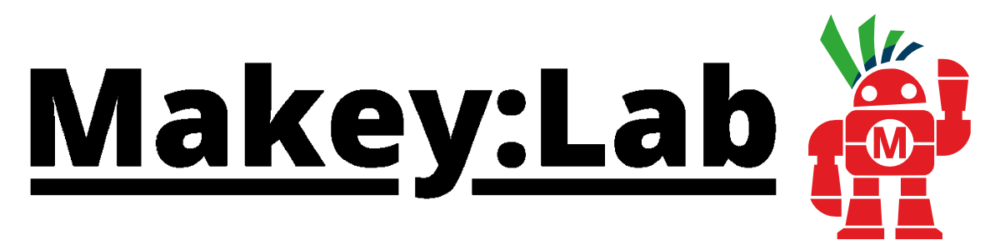

# Makey:Lab - Die neue IoT Lern- und Experimentierplattform

**Experimentieren, programmieren und Technik entdecken.**

**Makey:Lab** ist eine vielseitige Experimentier- und Lernplattform auf Basis des ESP32. Das Board vereint zahlreiche Sensoren, LEDs, Taster, einen Drehencoder, Audiofunktionen und Schnittstellen für eigene Erweiterungen.

Damit lassen sich viele Projekte direkt umsetzen – ohne zusätzliche Bauteile oder aufwendige Verkabelung.

Makey:Lab ist ein gemeinsames Projekt von **Make** und dem **Umwelt-Campus Birkenfeld der Hochschule Trier**.

## Willkommen in der Makey:Lab-Werkstatt!

Dieses Repository stellt ergänzende Materialien, Beispielprogramme und technische Informationen rund um Makey:Lab bereit.

Hier findest du:

- **Beispielprogramme:** Fertige Programme für die IoT-Werkstatt im `.abp`-Format.
- **Projekte und Experimente:** Ideen zum Nachbauen und Weiterentwickeln.
- **Hardware-Dokumentation:** Informationen zu Sensoren, Anschlüssen und Erweiterungsmöglichkeiten.
- **Software:** Informationen und Downloads rund um die Programmierung von Makey:Lab.

Die Inhalte werden laufend ergänzt.

## Programmieren mit der IoT-Werkstatt

Mit der **IoT-Werkstatt** lässt sich Makey:Lab besonders einfach programmieren. Die grafische Programmierumgebung ermöglicht einen schnellen Einstieg mit Blockly-Bausteinen. Fortgeschrittene können außerdem mit C++ arbeiten.

**➡️ [IoT-Werkstatt herunterladen – aktuelle Versionen](https://github.com/klausgollmer/IoT-Werkstatt-IoTW-Bundle/releases)**

So entstehen mit wenigen Bausteinen bereits erste Anwendungen – von der Wetterstation über die Umweltampel bis zum elektronischen Musikinstrument.

## Mitmachen

Du hast ein eigenes Projekt mit Makey:Lab entwickelt, eine spannende Idee oder möchtest deine Erfahrungen mit anderen teilen?

Dann schreib uns an **[community@makeylab.de](mailto:community@makeylab.de)**!

Wir freuen uns über Projektbeschreibungen, Fotos, Programme und Anregungen aus der Maker-Community. Besonders interessante Projekte möchten wir künftig auch auf unserer Makey:Lab-Website vorstellen.

## Hilfe und Kontakt

Du hast Fragen zu Makey:Lab, benötigst Unterstützung oder möchtest dich mit anderen austauschen?

In unserem **[Makey:Lab-Forum auf heise online](https://www.heise.de/forum/Make/Themen-Hilfe/Make-Education/Makey-Lab/forum-568292/)** kannst du Fragen stellen, Erfahrungen teilen und dich mit anderen Makern austauschen.

Du kannst uns auch direkt schreiben:

- **Technische Fragen und Support:** [support@makeylab.de](mailto:support@makeylab.de)
- **Allgemeine Anfragen und Informationen:** [info@makeylab.de](mailto:info@makeylab.de)
- **Community und Projekte:** [community@makeylab.de](mailto:community@makeylab.de)

## Weitere Informationen

- [Makey:Lab – offizielle Website](https://makeylab.de)
- [Make Magazin](https://www.heise.de/make/)
- [Make auf GitHub](https://github.com/MakeMagazinDE)

## Makey:Lab kaufen

Du möchtest selbst mit Makey:Lab experimentieren und eigene Projekte entwickeln?

**[➡️ Makey:Lab im heise Shop bestellen](https://shop.heise.de/makey-lab-iot-lern-und-experimentierplattform)**

Das Set enthält das Makey:Lab-Board, ein USB-Kabel und das umfangreiche Playbook mit zahlreichen Experimenten und Anleitungen.

---

## Herausgeber

Makey:Lab ist ein gemeinsames Projekt von **Make** und dem
**Umwelt-Campus Birkenfeld der Hochschule Trier**.

**Maker Media GmbH**  
[Make Magazin](https://www.heise.de/make/) ·
[Impressum](https://www.heise.de/make/Impressum)
